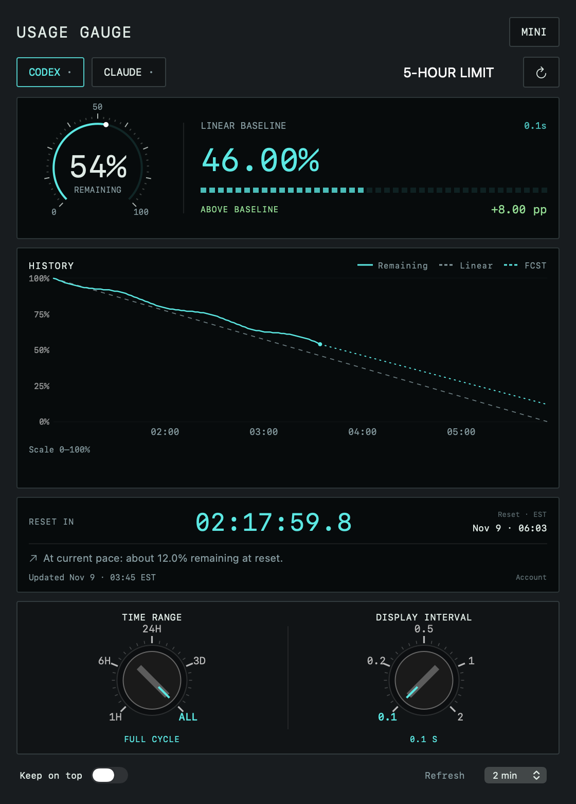
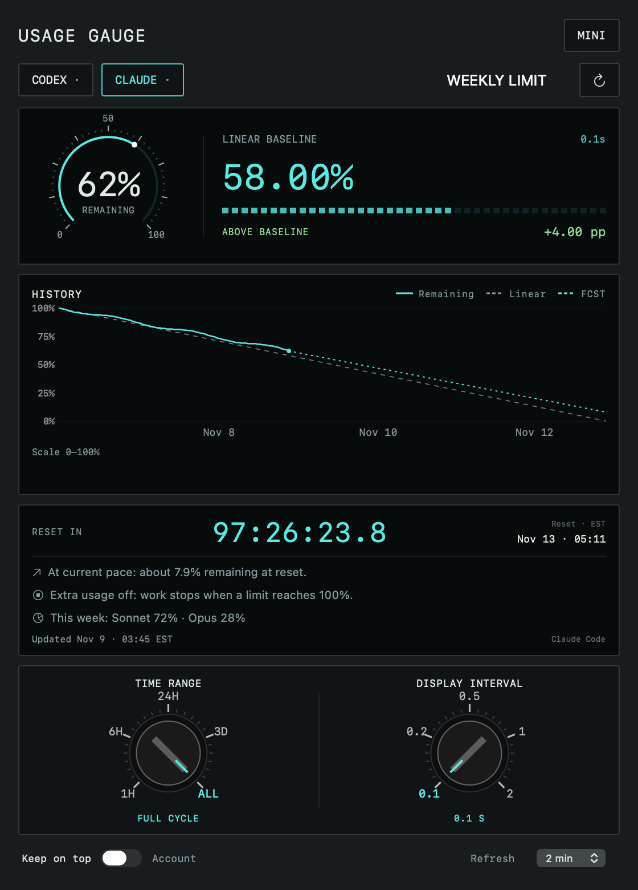
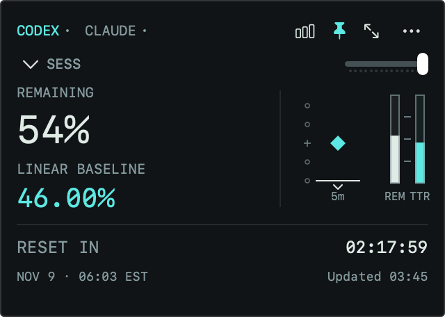
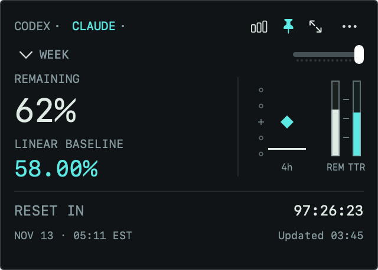
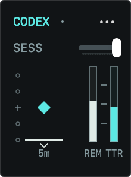
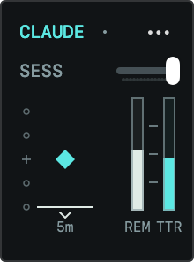
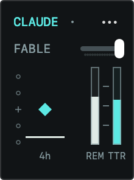
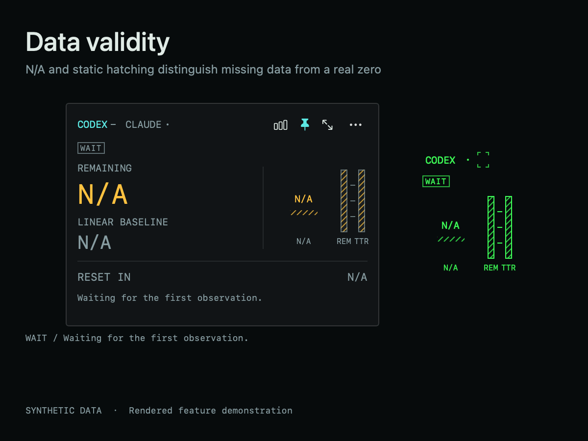
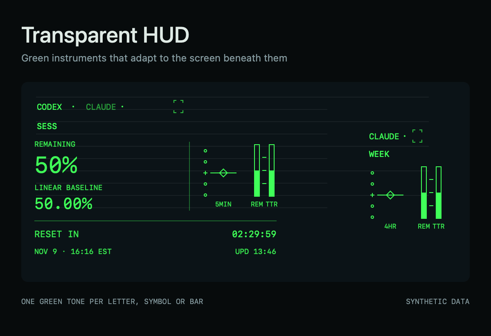

# Usage Gauge

**A cockpit instrument for your AI usage.**

Usage Gauge brings the visual language of aircraft instruments to Codex and Claude on macOS: a glideslope-inspired deviation display, detented rotary selectors, thin reference marks, and compact readouts. Keep it in a corner of your screen and see whether your remaining quota is above or below a linear budget through the next reset.

It runs in the menu bar without a Dock icon. Use the menu-bar gauges to show the window, change modes, or quit the app.

The cockpit influence is in the interaction, too. Your diamond stays fixed while the reference moves; the wheel changes scale one detent at a time; a direct red/service-color warning marks the upper limit. Open the full panel for history and forecasts, keep numbers beside the instrument in mini mode, or strip it down to symbols.


*All GIFs render the current app views with synthetic values, including native controls. They contain no account data. Motion is accelerated to make the reference bar visible.*

## Window modes

**Full window.** Remaining quota, a moving linear baseline, usage history, a consumption forecast, and reset time. Two rotary selectors control the graph's time range and the readout's display interval.

| Codex | Claude |
| --- | --- |
|  |  |

**Numeric mini · 320 × 228 points.** Exact remaining quota and linear baseline on the left, the symbol instrument on the right, and reset time below. Read the numbers and your pace together in a small window you can keep on top. The instrument keeps the same wheel/click scale selection and warning as symbols-only mode; its unit and spacing stay in sync when switching modes. Normal mode supports dragging the instrument; HUD mode uses only its corner-bracket handle. The opacity slider sits beside the limit selector.

| Codex | Claude |
| --- | --- |
|  |  |

*These stills render the actual app views with synthetic fixtures, including the native rotary controls. No account is connected or read during generation.*

**Symbols · 110 × 148 points.** The instrument shown above: a fixed diamond, moving budget reference, quota bar, and reset-time bar. The selected minutes, hours, or pp per dot stay visible beneath it.

| Codex · Session | Claude · Weekly |
| --- | --- |
|  |  |

| Claude · Session | Claude · Fable |
| --- | --- |
|  |  |

## Feature demos

**Head-down MFD and data validity.** Normal mode uses flat panels, restrained borders, monospaced instrument labels, white measurements and cyan selections/references. Amber and red carry caution and critical meanings rather than service branding. Missing readings retain their instrument positions with **N/A** and static diagonal hatching in both normal and HUD modes.



| Flag | Meaning |
| --- | --- |
| AUTH | Confirmed sign-in required; cached account values are hidden. |
| WAIT | Waiting for a first observation. |
| DATA / INVALID | A reading is unavailable or malformed. |
| STALE / RESET | Only explicitly marked LAST observations remain; live baseline, pace, reset countdown and forecast are inhibited. |
| IDLE | Usage is known, but the window has not started; baseline and time are N/A. |
| N/A | The account has no supported meters, or the specific field does not apply. |

A real **0%** stays a measured zero. Missing data never becomes an empty quota bar, a centered pace diamond, or a running countdown. Menu-bar readings also use N/A for unavailable or stale meters. A successful read restores the instruments automatically. Forecasts and history independently show N/A when there are insufficient observations.

The [v0.4 design notes](docs/design-v0.4.md) record the public human-engineering references, design interpretation and state contract. This is an aviation-inspired desktop display, not a certified military instrument.

**Transparent HUD.** Green instruments in numeric and symbol modes. Each letter, digit, symbol, and bar selects one readable green tone from the actual pixels behind its ink. Controls appear on hover; the hollow diamond blinks off and on for a pace warning. The app stays in the menu bar without a Dock icon.



*The HUD demo feeds synthetic background pixels through the app's own contrast classifier. It renders the shipping views, with staged hover and warning states; it does not record a desktop.*

**Time and pp scales.** Session minutes and percentage points have three wheel-selectable intervals. Weekly time has six: 2h, 4h, 8h, 1d, 2d, and 4d. The selected scale stays visible.


**Budget warning.** The center stays fixed while the white reference moves. At the upper limit, the diamond switches directly between red and the service color.


**Dragging and opacity.** Move the compact instrument by dragging the dot area or bottom label. Use the small slider beside the limit name to adjust opacity.


## The compact instrument

The **diamond stays at the center** and represents your current remaining quota. The **white horizontal bar moves** relative to it:

| White bar | Meaning |
| --- | --- |
| Above the diamond | You have less quota left than the linear budget calls for. |
| On the diamond | Your remaining quota matches the linear budget. |
| Below the diamond | You have more quota left than the linear budget calls for. |

The center is **your current state**, not 50% remaining. The two thin vertical bars show absolute remaining quota (battery icon, **REM** in HUD mode) and time remaining in the window (clock icon, **TTR** in HUD mode).

- Time-budget mode is the default. A 5-hour session starts at **5m/dot**; a weekly window starts at **4h/dot**. Scroll over the scale to change spacing: up for finer, down for wider. Click for a selection menu.
- Choose **`… → Dot unit → Percentage points`** to use the original **1, 2, or 5 pp/dot** scale. Time and pp selections are remembered separately, including separate session and weekly choices.
- The selected unit **stays visible below the scale**. The small slider beside the limit name adjusts mini-window opacity from **30–100%**, with the setting saved across launches.
- Choose **`… → HUD mode`** for green-only mini instruments on a transparent window. Uppercase monospaced service and window labels, square-ended bars, and a consistent thin stroke keep the display compact. The reference bar is slightly heavier. The bar captions are **REM** (remaining usage) and **TTR** (time to reset), with IDLE/RST when appropriate. Hover over the two top rows to reveal the options and opacity controls; they stay visible while the opacity slider is being dragged. Numeric HUD controls use short SYM, PIN, and FULL labels. A single faint, centered green edge keeps the marks readable without doubled strokes. HUD works in symbol and numeric mini modes and is remembered across launches. The opacity control and both menu-bar batteries also turn HUD green. The diamond is normally a bright hollow outline; pace warnings blink it fully off and on. The menu-bar menu offers the same HUD toggle and restores normal battery colors when HUD is turned off.
- HUD service marks use shape as well as presence: a small dot means normal limits, an outlined square means warning, a filled square means critical, and a short dash means unavailable or stale data. In symbol mode the mark beside the service name describes the other service; its tooltip names that service and its state. Numeric mode shows a mark beside each service.
- **`… → Automatic contrast`** reads the background beneath the mini HUD only, excluding Usage Gauge's own windows. It compares the two green tones' contrast at the actual ink pixels of each letter, digit, symbol, or individual bar, with one solid tone per entity. This avoids letting a little white background overwhelm a letter mostly overlapping black text. Empty glyph space, the hollow diamond center, and transparent input surfaces do not contribute. Overlapping symbols retain their visible drawing order. The app caches its own foreground coverage when text or instrument geometry changes; background frames reuse that coverage. A small hysteresis band prevents rapid switching when the contrast preferences are close. The menu-bar batteries keep their fixed HUD green. A cropped, event-driven stream supports up to 30 updates per second; idle frames and unchanged tone decisions are skipped, and classification runs off the main thread. Screen Recording permission is required. Only cropped images are processed in memory; no screen images or audio are saved or transmitted. Without permission, the HUD keeps its bright green and offers **Allow background access…** in the options menu.
- In HUD mode, the scroll target is the diamond's bounding square, including its hollow center. A nearly invisible input surface keeps that empty center interactive. Four open corner brackets between the service name and options form the drag handle. Only their interior moves the window, and the brackets brighten slightly while hovered. Service names remain clickable, while dragging a name, the diamond, the scale label, or the background does not move the HUD.
- In normal mode, **drag the dot scale or its bottom label to move the window.** A click on the scale without dragging opens the spacing menu. Buttons and the opacity slider retain their own actions.
- Two dots above and below the center cross define the equally spaced difference scale.
- The diamond's top and bottom mark ±0.4 dot around the center: ±2 equivalent budget minutes at 5m/dot. Its full height is 80% of one dot interval, so its reading band changes with the selected scale.
- The bottom scale label stays short (`5m`, `2h`, or `2pp`); the menu and tooltip explain the per-dot spacing.
- The difference scale sits to the left of the diamond. Between the usage and time bars, a separate shared scale marks 25%, 50%, and 75% with identical short horizontal ticks; each bar runs from 0% at the bottom to 100% at the top.
- At the upper limit, the diamond alternates between the service color and red every **0.8 seconds**, without fading. A chevron marks values beyond the scale. The warning threshold follows the selected unit and spacing; it is not a provider-defined quota alert.
- With macOS Reduce Motion enabled, the warning is steady red in normal mode or a steady hollow green diamond in HUD mode. An unavailable or stale observation pauses the warning and shows a status icon.
- The symbol window is **110 × 148 points**. Choose the service at the top; the `…` menu contains pinning, values, full window, refresh, and corner placement.
- Click the service or limit name to open its menu. Symbol mode keeps the limit label short (`Session`, `Weekly`, or a model name such as `Fable`) and reserves room for warning icons and opacity; the menu shows the full limit names.

The full window adds history, a consumption forecast when enough observations exist, and rotary selectors for time range and display interval. The numeric mini window pairs remaining quota and baseline numbers with the symbol instrument, with reset time below.

| Scale | Default | Wheel choices | Range at default |
| --- | --- | --- | --- |
| Session (5 hours) | **5m/dot** | 5, 10, 15 minutes | ±10 minutes |
| Weekly | **4h/dot** | 2h, 4h, 8h, 1d, 2d, 4d | ±8 hours |
| Percentage points | 2 pp/dot | 1, 2, 5 pp | ±4 pp |

Time means **equivalent consumption ahead of or behind the linear budget**. For example, a reference bar 10 minutes above center means you have used 10 minutes' worth of the linear budget early. It does not mean the quota will run out 10 minutes early. Other window durations use minute choices below one day and hour choices from one day onward, converted using their actual duration.

## Build and run

Requirements: **macOS 14 or newer**, Apple Command Line Tools with a recent Swift compiler, and Python 3 at `/usr/bin/python3`. The build uses Apple frameworks and the Python standard library; no package manager dependencies are needed. Apple Silicon is tested. The build also selects an Intel target on Intel Macs, but that configuration has not been tested.

```sh
git clone https://github.com/BrianBrianOh/usage-gauge.git
cd usage-gauge
zsh native/build.sh
open "dist/Usage Gauge.app"
```

If Command Line Tools are missing, install them with `xcode-select --install`. A full Xcode installation also works.

To keep the app:

```sh
mkdir -p "$HOME/Applications"
ditto "dist/Usage Gauge.app" "$HOME/Applications/Usage Gauge.app"
open "$HOME/Applications/Usage Gauge.app"
```

The [latest release](https://github.com/BrianBrianOh/usage-gauge/releases/latest) includes a ZIP of the app for **Apple Silicon** and a SHA-256 checksum. Extract the ZIP and move **Usage Gauge.app** to Applications. Intel users can build from source; that configuration has not been tested.

Builds are ad-hoc signed, not Developer ID signed or notarized. macOS may require you to approve the downloaded app in **System Settings → Privacy & Security**. Rebuilding or replacing an ad-hoc signed app may also require reconnecting its Screen Recording permission for HUD automatic contrast.

## Connect your accounts

**Codex:** install and sign in to the Codex CLI or desktop app. Usage Gauge asks its local `app-server` for `account/read` and `account/rateLimits/read`. A subscription with usage limits is required; an API-key account may not provide these meters.

**Claude:** install and sign in to Claude Code with your Claude subscription. Usage Gauge sends a `get_usage` control request without a prompt. The CLI remains responsible for its own credentials. If needed, the full window's **Account** button also provides a separate claude.ai email-sign-in connection. Google passkey sign-in is not supported inside that embedded window.

Usage is polled every two minutes by default; the full window offers 1, 2, 5, or 15 minutes. The 0.1–2 second display interval only redraws local instruments. It does **not** poll your account at that speed. Nothing schedules tasks in Codex or sends inference prompts.

The app must be running and the Mac awake to collect observations. It refreshes on wake. There is no background LaunchAgent or cloud service.

## How the baseline works

For a provider-reported window of duration `D` and reset time `R`:

```text
baseline(t) = clamp(100 × (R − t) / D, 0, 100)
deviation(t) = baseline(t) − last_observed_remaining
budget_minutes_ahead(t) = deviation(t) × window_duration_minutes / 100
```

The baseline moves with time. Actual remaining quota changes only after a successful observation. A linear budget is a planning reference; it does not predict provider capacity, replenish quota, or guarantee a future reset. Idle windows and expired windows awaiting a new observation are handled separately.

## Privacy

- No account snapshots, usage histories, login sessions, cookies, tokens, or developer account identifiers are included in the repository, demo, or app bundle. Fresh installs start empty.
- Observations are stored on your Mac under `~/Library/Application Support/Usage Gauge/`. History is separated by account and reset cycle.
- The Codex reader hashes the account identity locally. The Claude reader reads the local organization identifier for history separation and stores a hash. It does not copy CLI tokens. The optional web sign-in uses WebKit's local website data store.
- No analytics, telemetry, external asset hosting, or Usage Gauge server. CLI and web requests go to the corresponding service through your existing connection.
- Error states preserve the last observation time rather than presenting cached data as fresh. Local files may still contain private usage information; do not attach them to public issues.

## Troubleshooting

For Claude, try the Claude Code usage screen first, confirm the subscription sign-in, and update Claude Code if its control protocol has changed. Usage Gauge retries a temporary read failure once, then reports the failure with the old observation intact. A late embedded-page error cannot overwrite a successful CLI read.

For Codex, verify that the installed CLI or desktop app is signed in. An unavailable usage meter is shown as an error rather than invented values.

These integrations depend on provider tools and usage response formats that may change. Usage Gauge is an independent project, not affiliated with OpenAI or Anthropic.

## Development

```sh
python3 -m unittest discover -s tests -v
zsh native/build.sh
"dist/Usage Gauge.app/Contents/MacOS/UsageGauge" --self-test
python3 tools/check_publication.py
zsh tools/generate-demo.sh
zsh tools/generate-hud-demo.sh
zsh tools/generate-screenshots.sh
zsh tools/generate-validity-screenshots.sh
```

The tests cover account/cycle isolation, typed auth failures and recovery, Claude retry and account-switch handling, quota parsing, forecasts, time and vertical scales, mini-window placement, time-budget conversion, dot spacing, warning boundaries, binary warning timing, menu-bar label fit and HUD ink masks. The validity renderer checks 90 provider/state/layout combinations, plus real zero/full readings, inhibited indications, quarter ticks and complete-entity HUD contrast. Documentation generators host the actual app views off screen with the same compile-time in-memory model and native controls. GIFs use a fixed animation sample time for the binary warning. The HUD generator also uses the shipping contrast classifier on synthetic background pixels. Generators do not capture the desktop, load preferences, read accounts, or start collectors.

Licensed under [MIT](LICENSE).
