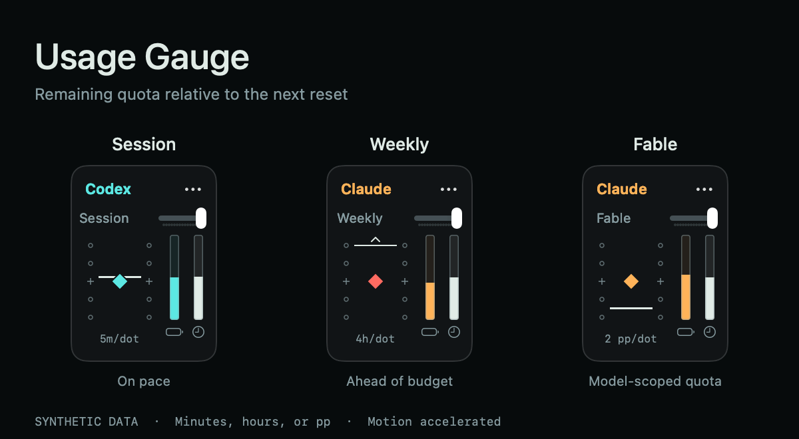
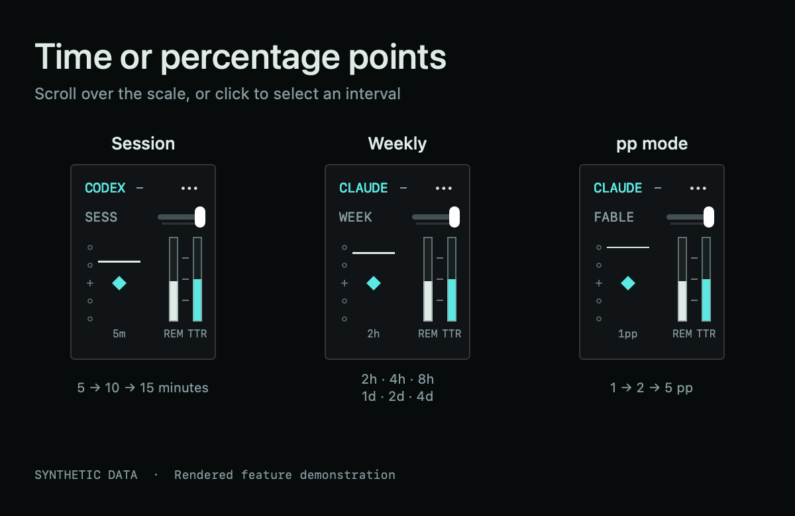
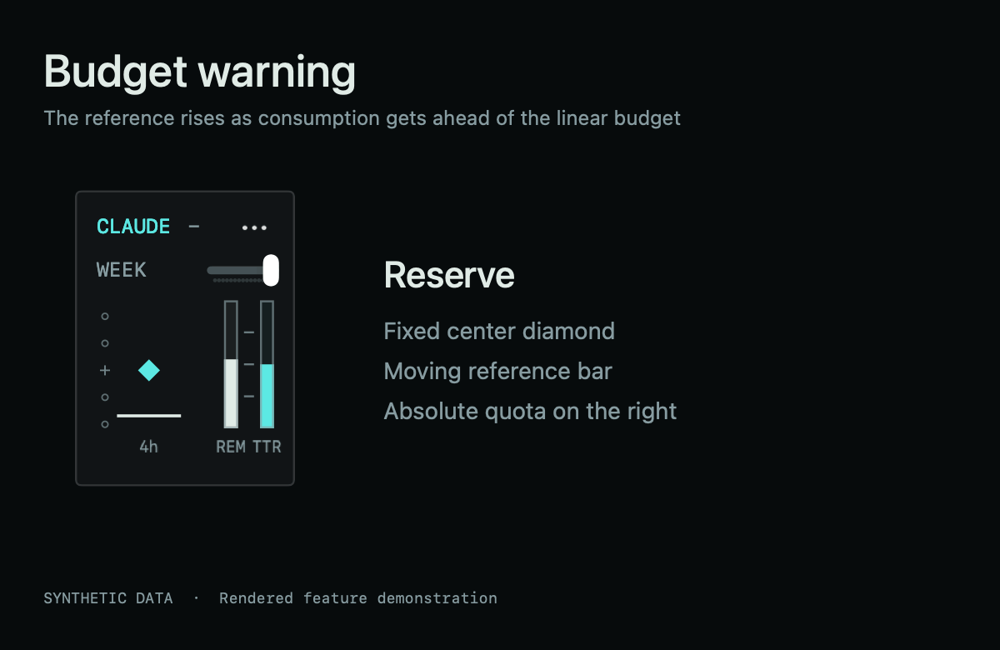
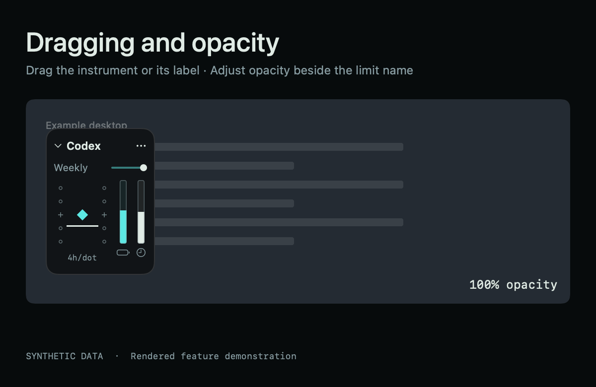

# Usage Gauge

A small macOS instrument for Codex and Claude subscription usage. Compare your remaining quota with a linear budget through the next reset.



*All GIFs are rendered feature demonstrations using synthetic values and the app's instrument components. They contain no account data. Motion is accelerated to make the reference bar visible.*

## Feature demos

**Time and pp scales.** Session minutes, weekly hours, and percentage points each have three wheel-selectable intervals. The selected scale stays visible.



**Budget warning.** The center stays fixed while the white reference moves. At the upper limit, the diamond switches directly between red and the service color.



**Dragging and opacity.** Move the compact instrument by dragging the dot area or bottom label. Use the small slider beside the limit name to adjust opacity.



## The compact instrument

The **diamond stays at the center** and represents your current remaining quota. The **white horizontal bar moves** relative to it:

| White bar | Meaning |
| --- | --- |
| Above the diamond | You have less quota left than the linear budget calls for. |
| On the diamond | Your remaining quota matches the linear budget. |
| Below the diamond | You have more quota left than the linear budget calls for. |

The center is **your current state**, not 50% remaining. The two thin vertical bars show absolute remaining quota (battery icon) and time remaining in the window (clock icon).

- Time-budget mode is the default. A 5-hour session starts at **5m/dot**; a weekly window starts at **4h/dot**. Scroll over the scale to change spacing: up for finer, down for wider. Click for a selection menu.
- Choose **`… → Dot unit → Percentage points`** to use the original **1, 2, or 5 pp/dot** scale. Time and pp selections are remembered separately, including separate session and weekly choices.
- The selected unit **stays visible below the scale**. The small slider beside the limit name adjusts mini-window opacity from **30–100%**, with the setting saved across launches.
- **Drag the dot scale or its bottom label to move the window.** A click without dragging still opens the spacing menu. Buttons and the opacity slider retain their own actions.
- Two dots on either side define the visible range. Center crosses complete the equally spaced scale.
- At the upper limit, the diamond alternates between the service color and red every **0.8 seconds**, without fading. A chevron marks values beyond the scale. The warning threshold follows the selected unit and spacing; it is not a provider-defined quota alert.
- With macOS Reduce Motion enabled, the warning is steady red. An unavailable or stale observation pauses the warning and shows a status icon.
- The symbol window is **110 × 148 points**. Choose the service at the top; the `…` menu contains pinning, values, full window, refresh, and corner placement.

The full window adds history, a consumption forecast when enough observations exist, and rotary selectors for time range and display interval. The numeric mini window shows remaining quota, baseline, and reset time.

| Scale | Default | Wheel choices | Range at default |
| --- | --- | --- | --- |
| Session (5 hours) | **5m/dot** | 5, 10, 15 minutes | ±10 minutes |
| Weekly | **4h/dot** | 2, 4, 8 hours | ±8 hours |
| Percentage points | 2 pp/dot | 1, 2, 5 pp | ±4 pp |

Time means **equivalent consumption ahead of or behind the linear budget**. For example, a reference bar 10 minutes above center means you have used 10 minutes' worth of the linear budget early. It does not mean the quota will run out 10 minutes early. Other window durations use minute choices below one day and hour choices from one day onward, converted using their actual duration.

## Build and run

Requirements: **macOS 14 or newer**, Apple Command Line Tools with a recent Swift compiler, and Python 3 at `/usr/bin/python3`. The build uses Apple frameworks and the Python standard library; no package manager dependencies are needed. Apple Silicon is tested. The build also selects an Intel target on Intel Macs, but that configuration has not been tested.

```sh
git clone https://github.com/BrianBrianOh/usage-gauge.git
cd usage-gauge
zsh native/build.sh
open "dist/Usage Gauge.app"
```

If Command Line Tools are missing, install them with `xcode-select --install`. A full Xcode installation also works.

To keep the app:

```sh
mkdir -p "$HOME/Applications"
ditto "dist/Usage Gauge.app" "$HOME/Applications/Usage Gauge.app"
open "$HOME/Applications/Usage Gauge.app"
```

This initial release is source-first. Local builds are ad-hoc signed, not Developer ID signed or notarized. No prebuilt installer is published.

## Connect your accounts

**Codex:** install and sign in to the Codex CLI or desktop app. Usage Gauge asks its local `app-server` for `account/read` and `account/rateLimits/read`. A subscription with usage limits is required; an API-key account may not provide these meters.

**Claude:** install and sign in to Claude Code with your Claude subscription. Usage Gauge sends a `get_usage` control request without a prompt. The CLI remains responsible for its own credentials. If needed, the full window's **Account** button also provides a separate claude.ai email-sign-in connection. Google passkey sign-in is not supported inside that embedded window.

Usage is polled every two minutes by default; the full window offers 1, 2, 5, or 15 minutes. The 0.1–2 second display interval only redraws local instruments. It does **not** poll your account at that speed. Nothing schedules tasks in Codex or sends inference prompts.

The app must be running and the Mac awake to collect observations. It refreshes on wake. There is no background LaunchAgent or cloud service.

## How the baseline works

For a provider-reported window of duration `D` and reset time `R`:

```text
baseline(t) = clamp(100 × (R − t) / D, 0, 100)
deviation(t) = baseline(t) − last_observed_remaining
budget_minutes_ahead(t) = deviation(t) × window_duration_minutes / 100
```

The baseline moves with time. Actual remaining quota changes only after a successful observation. A linear budget is a planning reference; it does not predict provider capacity, replenish quota, or guarantee a future reset. Idle windows and expired windows awaiting a new observation are handled separately.

## Privacy

- No account snapshots, usage histories, login sessions, cookies, tokens, or developer account identifiers are included in the repository, demo, or app bundle. Fresh installs start empty.
- Observations are stored on your Mac under `~/Library/Application Support/Usage Gauge/`. History is separated by account and reset cycle.
- The Codex reader hashes the account identity locally. The Claude reader reads the local organization identifier for history separation and stores a hash. It does not copy CLI tokens. The optional web sign-in uses WebKit's local website data store.
- No analytics, telemetry, external asset hosting, or Usage Gauge server. CLI and web requests go to the corresponding service through your existing connection.
- Error states preserve the last observation time rather than presenting cached data as fresh. Local files may still contain private usage information; do not attach them to public issues.

## Troubleshooting

For Claude, try the Claude Code usage screen first, confirm the subscription sign-in, and update Claude Code if its control protocol has changed. Usage Gauge retries a temporary read failure once, then reports the failure with the old observation intact. A late embedded-page error cannot overwrite a successful CLI read.

For Codex, verify that the installed CLI or desktop app is signed in. An unavailable usage meter is shown as an error rather than invented values.

These integrations depend on provider tools and usage response formats that may change. Usage Gauge is an independent project, not affiliated with OpenAI or Anthropic.

## Development

```sh
python3 -m unittest discover -s tests -v
zsh native/build.sh
"dist/Usage Gauge.app/Contents/MacOS/UsageGauge" --self-test
python3 tools/check_publication.py
zsh tools/generate-demo.sh
```

The tests cover account/cycle isolation, Claude retry and account-switch handling, quota parsing, forecasts, time and vertical scales, mini-window placement, time-budget conversion, dot spacing, warning boundaries, and binary warning timing. Demo generation renders synthetic SwiftUI views into GIF frames using Apple's ImageIO, without reading accounts or running collectors.

Licensed under [MIT](LICENSE).
